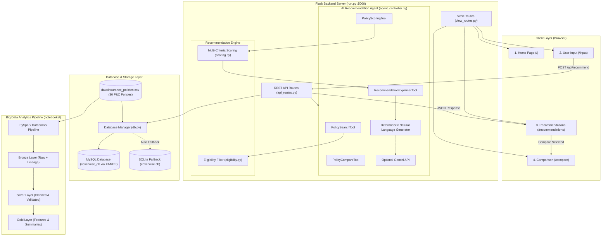
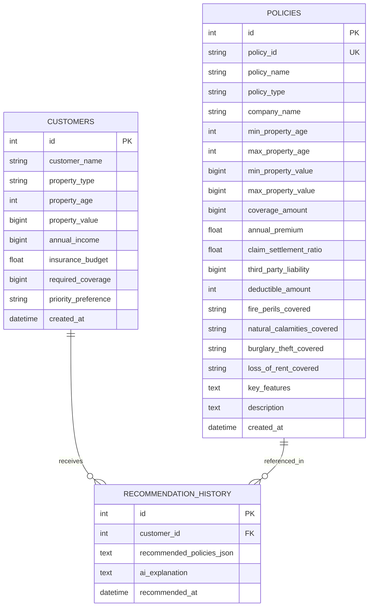

# CoverWise AI – Property & Casualty Insurance Recommendation Agent

> **A beginner-friendly, full-stack Insurance Recommendation Web Application built with Python Flask, MySQL / SQLite (SQLAlchemy ORM), Apache Spark / Databricks (Medallion Architecture), and an AI Advisory Agent.**

---

## 📌 1. Project Introduction

**CoverWise AI** is an intelligent web application designed to help individuals, families, retail shopkeepers, and landlords discover the best **Property & Casualty (P&C) Insurance policies** tailored to their exact needs.

Unlike traditional insurance websites that overwhelm users with confusing legal jargon or push sponsored policies, CoverWise AI uses a **transparent, mathematical multi-criteria scoring algorithm** and a **modular AI agent** to analyze 30+ real-world insurance plans and explain in plain English why a specific policy fits the user's property valuation, building age, casualty risk, and budget.

---

## ❗ 2. Problem Statement

Selecting the right Property & Casualty insurance policy is notoriously difficult for everyday consumers and small business owners due to several key pain points:

1. **Complex Policy Terms & Fine Print**: Policies use confusing terms like "sum insured sub-limits", "excess deductibles", "third-party casualty liability", and "named perils".
2. **Sales Commission Bias**: Traditional brokers often push policies that offer them the highest commissions rather than what is best for the customer.
3. **Mismatched Coverage**: Homeowners often mistakenly buy policies that only cover the building structure but exclude household contents, burglary, or neighbor water leakage liability.
4. **Lack of Instant Transparency**: Consumers rarely know *why* one policy is recommended over another.

---

## 🎯 3. Objectives

- **Automate Policy Discovery**: Allow users to input their property details in under 60 seconds and receive instant, ranked recommendations.
- **Provide Unbiased Multi-Factor Ranking**: Evaluate policies across four critical dimensions:
  1. *Coverage Adequacy* (30%)
  2. *Budget Affordability* (25%)
  3. *Claim Settlement Ratio (CSR)* (25%)
  4. *Peril & Casualty Liability Protection* (20%)
- **Deliver Plain-Language AI Explanations**: Generate an easy-to-understand **"Why recommended?"** justification for every suggested policy.
- **Enable Side-by-Side Visual Comparison**: Provide visual progress meters and a side-by-side feature matrix to compare 2 or 3 policies.
- **Demonstrate Medallion Big Data Engineering**: Cleanse and transform insurance data through PySpark Bronze, Silver, and Gold Delta layers for analytical readiness.
- **Ensure Zero-Friction Local Execution**: Run out-of-the-box on any student machine using automatic SQLite fallback if XAMPP MySQL is not started.

---

## 🚀 4. Features: Implemented vs. Planned

| Feature Category | Implemented Features (Working Now) | Planned Features (Future Scope) |
| :--- | :--- | :--- |
| **User Interface** | • Clean White & Light Blue modern theme<br>• Fully responsive across mobile, tablet, desktop<br>• 4 streamlined pages (Home, Input, Recommendations, Comparison)<br>• Three 1-click test profile buttons | • User registration & profile saving<br>• PDF quote export / download<br>• Dark mode toggle |
| **Data & Recommendations** | • 30 curated Property & Casualty policies<br>• Multi-criteria suitability scoring (0–100%)<br>• Automated eligibility filtering with soft boundary relaxation<br>• Top 3 ranked recommendations with smart badges | • Real-time API scraping of live insurance rates<br>• User review & ratings integration |
| **AI Agent & Advisory** | • Modular 4-tool AI Agent architecture<br>• Deterministic Natural Language Generation (works 100% offline without API keys)<br>• Optional Google Gemini LLM API enhancement | • Conversational multi-turn chatbot interface<br>• Computer Vision for property damage inspection from photos |
| **Data Processing** | • PySpark Medallion Pipeline (`databricks_insurance_pipeline.py` & `.ipynb`)<br>• Bronze (Raw), Silver (Cleaned), Gold (Features & Summary) Delta tables | • Streaming ingestion of policy claims via Apache Kafka |
| **Database** | • Dual-database connection manager (MySQL via XAMPP + auto SQLite fallback)<br>• SQLAlchemy ORM models (`Policy`, `Customer`, `RecommendationHistory`)<br>• Automated CSV-to-DB seeder on first startup | • Cloud database hosting on AWS RDS / GCP Cloud SQL |

---

## 🛠️ 5. Technologies Used and Why

| Technology | Role | Why It Was Chosen |
| :--- | :--- | :--- |
| **Python 3.12** | Core Programming Language | Clean syntax, powerful mathematical libraries, and standard industry adoption for AI and data science. |
| **Flask** | Web Backend Framework | Lightweight and beginner-friendly micro-framework. Unlike Django, Flask has minimal boilerplate and makes routing and API development transparent. |
| **SQLAlchemy ORM** | Object-Relational Mapping | Allows interacting with database tables using Python classes (`Policy`, `Customer`) instead of writing raw SQL strings, preventing SQL injection. |
| **MySQL (XAMPP)** | Relational Database (Primary) | Industry standard relational database, easily managed locally via XAMPP Control Panel and phpMyAdmin. |
| **SQLite3** | Relational Database (Fallback) | Serverless, zero-configuration local database bundled with Python. Ensures the project runs seamlessly on any evaluator's computer even if MySQL is off. |
| **PySpark & Databricks** | Big Data Processing | Distributed data computing engine implementing the Medallion Architecture (Bronze $\rightarrow$ Silver $\rightarrow$ Gold) for enterprise data governance. |
| **HTML5 & CSS3** | Frontend Presentation | Custom clean white and light blue CSS design without heavy external frameworks (no Node.js/npm required), keeping load times instant. |
| **JavaScript (Vanilla)** | Frontend Logic & Interactivity | Handles form submission (`fetch` API), dynamic card rendering, toast notifications, and client-side comparison state (`sessionStorage`). |
| **Google Gemini API** *(Optional)* | Generative AI Enhancement | Optional integration for rich natural language summaries if a free `GEMINI_API_KEY` is provided in `.env`. |

---

## 🏗️ 6. Project Architecture



---

## ⚙️ 7. Installation and Setup Instructions

### Prerequisites
- **Python**: Version 3.10, 3.11, or 3.12 installed.
- **Code Editor**: Visual Studio Code (recommended).
- **Web Browser**: Chrome, Edge, or Firefox.
- **XAMPP** *(Optional)*: If you want to run MySQL locally.

### Step 1: Open Project in VS Code
Open VS Code, click **File $\rightarrow$ Open Folder...**, and select the `policyassist-ai` directory.

### Step 2: Open Terminal & Create Virtual Environment (Recommended)
Open the integrated terminal in VS Code (`Ctrl + ~` on Windows) and run:
```bash
# Create a virtual environment named 'venv'
python -m venv venv

# Activate on Windows:
venv\Scripts\activate

# Activate on macOS/Linux:
# source venv/bin/activate
```

### Step 3: Install Required Packages
```bash
pip install -r requirements.txt
```

### Step 4 (Optional): Start XAMPP MySQL
1. Open the **XAMPP Control Panel**.
2. Click **Start** next to **Apache** and **MySQL**.
3. *Note: If you do not have XAMPP running, the application will automatically detect that port 3306 is closed and will seamlessly fall back to local SQLite (`coverwise.db`). Nothing will crash!*

---

## 🏃 8. How to Run the Project

In your terminal, execute:
```bash
python run.py
```

You will see output similar to:
```text
[DATABASE INFO] MySQL (XAMPP) is not accessible on localhost:3306.
[DATABASE INFO] Falling back to SQLite: sqlite:///.../coverwise.db
[DATABASE] Tables created or verified successfully.
[SEED SUCCESS] Seeded 30 Property & Casualty policies into database.
=================================================================
 🚀 CoverWise AI – Property & Casualty Insurance Agent
=================================================================
 Web Server running at: http://127.0.0.1:5000/
 Pages available:
   • Home:             http://127.0.0.1:5000/
   • User Input:       http://127.0.0.1:5000/input
   • Recommendations:  http://127.0.0.1:5000/recommendations
   • Policy Compare:   http://127.0.0.1:5000/compare
=================================================================
```

Open your browser and navigate to: **`http://127.0.0.1:5000/`**.

---

## 🧠 9. How the Recommendation System Works

The recommendation engine follows a structured 4-step decision process:

### Step 1: Eligibility Filtering (`src/recommender/eligibility.py`)
When a user submits their property profile, the system filters out ineligible policies using strict constraints:
- **Building Age**: `policy.min_property_age <= property_age <= policy.max_property_age`
- **Valuation Bounds**: `policy.min_property_value <= property_value <= policy.max_property_value`
- **Category Compatibility**: Matches user selection (e.g., Residential Apartment matches Apartment and Comprehensive plans).
- **Budget Margin**: Discards policies whose premium exceeds the user's budget by more than 30%.
- *Fallback Relaxation*: If strict filtering produces fewer than 3 policies, the filter automatically relaxes non-critical boundaries so the user always receives actionable suggestions.

### Step 2: Multi-Criteria Mathematical Scoring (`src/recommender/scoring.py`)
Every eligible policy is evaluated on a 0–100 scale across 4 weighted components:

$$\text{Suitability Score} = 0.30 \times S_{\text{Coverage}} + 0.25 \times S_{\text{Budget}} + 0.25 \times S_{\text{CSR}} + 0.20 \times S_{\text{Features}}$$

1. **Coverage Adequacy Score ($S_{\text{Coverage}}$, 30%)**:
   - Compares Policy Sum Insured against Requested Sum Insured.
   - If coverage $\ge$ requested: gives 90–100 points.
   - If coverage $<$ requested: scales linearly: $\text{Ratio} \times 90$.
2. **Budget Fit Score ($S_{\text{Budget}}$, 25%)**:
   - If premium $\le$ budget: rewards lower cost while staying above 75 points: $100 - (\frac{\text{Premium}}{\text{Budget}} \times 12)$.
   - If premium $>$ budget: penalizes excess rapidly: $100 - (\frac{\text{Excess}}{\text{Budget}} \times 160)$.
3. **Claim Settlement Ratio Score ($S_{\text{CSR}}$, 25%)**:
   - Insurers with $\text{CSR} \ge 98\%$ receive 100 points; $96\%\text{--}98\%$ receive 92–98 points; below $93\%$ receive 70–82 points.
4. **Perils & Casualty Liability Score ($S_{\text{Features}}$, 20%)**:
   - Third-Party Casualty Liability Cover ($\ge ₹10\text{L} \rightarrow +24\text{ to }30\text{ pts}$).
   - Natural Calamities Cover (Flood, Earthquake, Cyclone $\rightarrow +25\text{ pts}$).
   - Burglary & Housebreaking Cover ($\rightarrow +25\text{ pts}$).
   - Loss of Rent / Alternative Living ($\rightarrow +20\text{ pts}$).

### Step 3: Ranking & Smart Badges
Policies are sorted in descending order of total score. The top 3 are assigned intuitive badges:
- **Rank 1**: *"Best Overall P&C Shield"*
- **Rank 2**: *"Top Claim Reliability"*
- **Rank 3**: *"Budget Smart Cover"*

### Step 4: Natural Language Explanation Generation (`src/agent/tools.py`)
The `RecommendationExplainerTool` generates a clear, customer-centric advisory explaining:
- Exact annual premium and money saved compared to budget.
- Sum insured replacement value.
- Casualty liability limit protecting against third-party lawsuits.
- Why this plan outperformed competing options.

---

## 🗄️ 10. Database Explanation

### Entity-Relationship (ER) Overview
The database consists of three relational tables managed by SQLAlchemy:



### Dual-Database Resilience Architecture
In `database/db.py`, the application tests whether MySQL on `localhost:3306` is accepting connections:
- **Case 1 (XAMPP running)**: Connects to MySQL, executes `CREATE DATABASE IF NOT EXISTS coverwise_db`, and uses `mysql+pymysql://root:@localhost:3306/coverwise_db`.
- **Case 2 (XAMPP stopped)**: Catches the connection timeout error and falls back to `sqlite:///coverwise.db` with a friendly console notification.

---

## ☁️ 11. Databricks / PySpark Integration

In enterprise environments, insurance datasets are processed through the **Medallion Architecture** using Apache Spark and Delta Lake. The file `notebooks/databricks_insurance_pipeline.py` implements this:

1. **Bronze Layer (Raw Ingestion)**:
   - Ingests raw `insurance_policies.csv`.
   - Appends audit metadata: `ingestion_timestamp` and `source_file`.
   - Stores raw immutable state in Delta format.
2. **Silver Layer (Data Cleansing & Validation)**:
   - Trims whitespace and casts text to numeric types (`IntegerType`, `DoubleType`, `LongType`).
   - Applies business quality validation: filters out invalid premiums ($\le 0$), negative coverages, and unreasonable Claim Settlement Ratios ($< 70\%$).
   - Stores clean, query-ready records in Delta format.
3. **Gold Layer (Feature Engineering & Aggregations)**:
   - Computes analytical metrics: `coverage_per_rupee` and `liability_ratio`.
   - Segments policies into `affordability_tier` and `csr_tier`.
   - Aggregates metrics by `policy_type` (Average premium, Average sum insured, Policy counts).

---

## 🤖 12. AI Agent Functionality

The AI Agent (`PolicyAssistAgent` in `src/agent/agent_controller.py`) follows the **Tool-Calling Agent Design Pattern**:

1. **`PolicySearchTool`**: Queries the policy catalog and filters by customer eligibility boundaries.
2. **`PolicyScoringTool`**: Calculates mathematical suitability scores and ranks the candidates.
3. **`PolicyCompareTool`**: Assembles side-by-side comparison matrices across policy features.
4. **`RecommendationExplainerTool`**: Synthesizes the customer's property profile and selected policies into a personalized narrative.
5. **`generate_enhanced_ai_explanation`**: An optional layer that sends the policy summary to Google Gemini (`gemini-2.5-flash`) if an API key is configured, or seamlessly falls back to the deterministic natural language generator if offline.

---

## 🔮 13. Future Scope

1. **Automated Property Valuation via Satellite / Maps API**: Estimate rebuilding costs automatically using location and square footage.
2. **Computer Vision Damage Assessment**: Enable users to upload photos of property damages to estimate repair costs and claim payouts.
3. **Payment Gateway & Policy Issuance**: Integrate Stripe or Razorpay to purchase selected policies directly.
4. **IoT Smart Home Sensor Integration**: Offer premium discounts to homes equipped with water-leak detectors, smoke alarms, and burglar alarm systems.
5. **Conversational Multi-Turn Chatbot**: Allow users to ask follow-up questions like *"Does Policy #1 cover earthquake damage in Gujarat?"* directly inside the browser.
