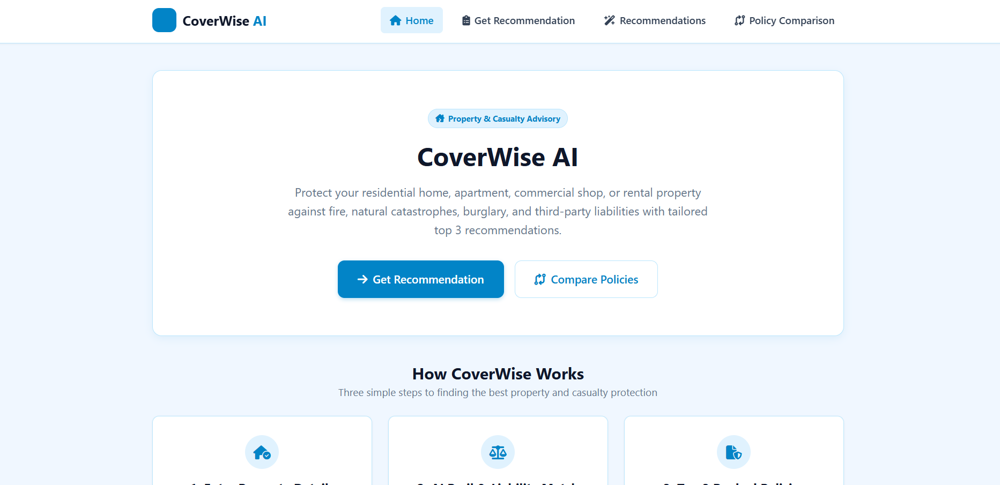
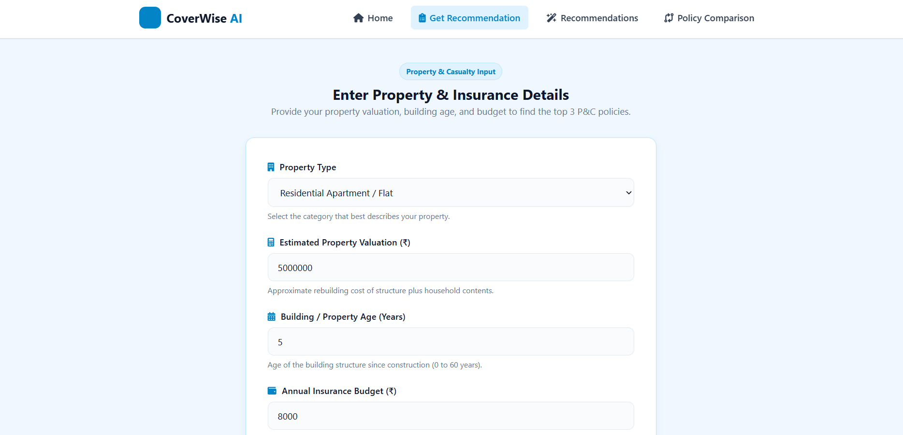
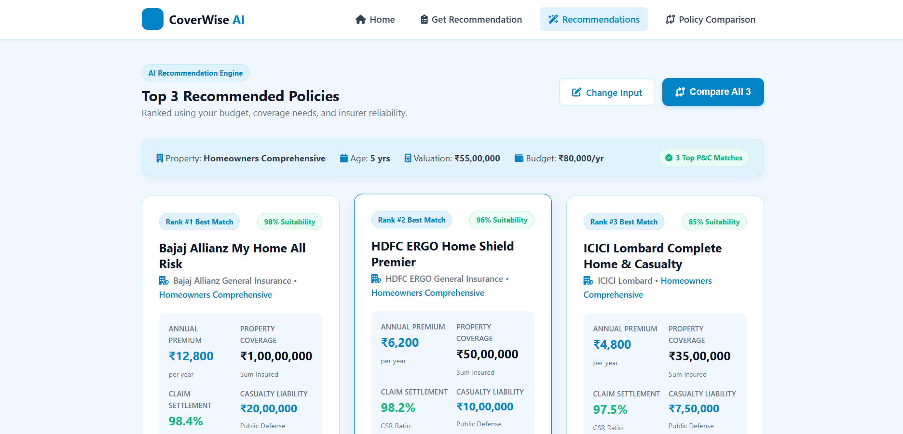
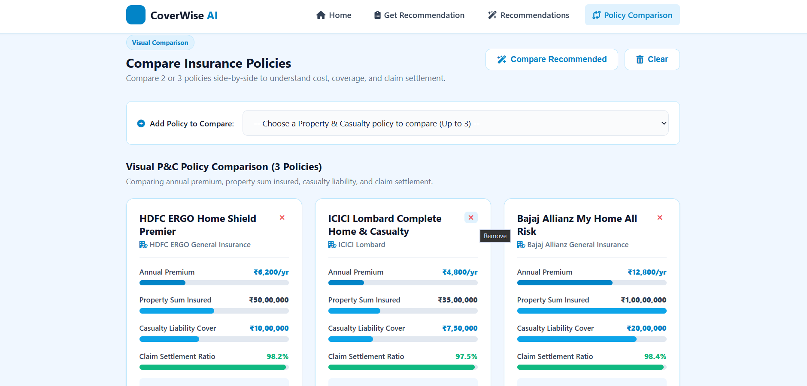

# CoverWise AI – Property & Casualty Insurance Recommendation Agent

## About the Project
CoverWise AI is a web application that helps individuals, homeowners, landlords, and small business owners find suitable Property & Casualty insurance policies based on their needs, property details, and budget.

It uses a recommendation system to filter, rank, and compare insurance policies, making the selection process easier and more transparent.

## Problem Statement
Choosing insurance can be difficult because of complex policy terms, different coverage options, premiums, and eligibility conditions. CoverWise AI simplifies this process by providing personalized recommendations and explaining why a policy is suitable.

## Features
- Personalized insurance recommendations
- Policy filtering based on property details and budget
- Ranking of policies using a suitability score
- Top 3 recommended policies
- Policy comparison
- Simple and responsive user interface
- AI-generated explanations for recommendations

## Screenshots

### Home Page

### User Input Page

### Recommendations Page

### Policy Comparison

## Technologies Used
- Python
- Flask
- HTML, CSS, JavaScript
- MySQL / SQLite
- SQLAlchemy
- PySpark
- Databricks

## How It Works
1. The user enters property details, budget, and insurance requirements.
2. The system filters policies based on eligibility.
3. Suitable policies are ranked using a scoring algorithm.
4. The top 3 policies are recommended.
5. Users can compare policies and understand why they were recommended.

## Recommendation Algorithm
Policies are evaluated based on:

- Coverage Adequacy – 30%
- Budget Affordability – 25%
- Claim Settlement Ratio – 25%
- Policy Features – 20%

The system calculates a suitability score and ranks policies accordingly.

## Data Processing
The project uses PySpark and Databricks to process insurance data through the Bronze, Silver, and Gold layers of the Medallion Architecture.

## AI Agent
The AI agent supports policy searching, scoring, comparison, and recommendation explanations. It can work offline using predefined logic, with optional Google Gemini API integration.

## How to Run

1. Clone the repository.
2. Install dependencies using `pip install -r requirements.txt`.
3. Run the application using `python run.py`.
4. Open `http://127.0.0.1:5000/` in your browser.

## Future Scope
- Conversational insurance chatbot
- Real-time insurance policy data
- Property damage assessment using computer vision
- Online policy purchase integration

## Disclaimer
This project is developed for educational purposes. Insurance data is used for demonstration and should not be considered actual insurance information or financial advice.
